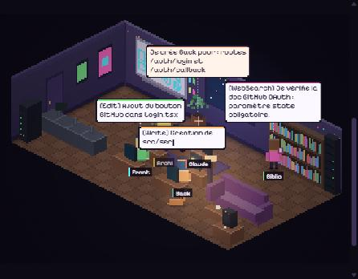
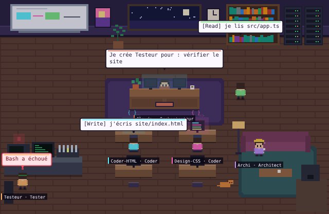
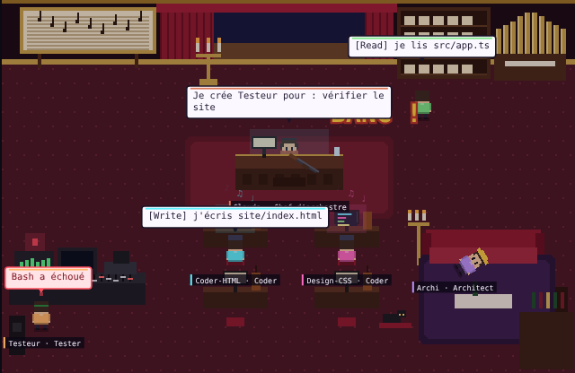
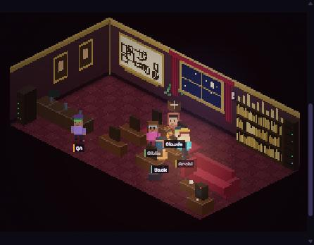
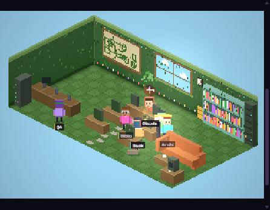
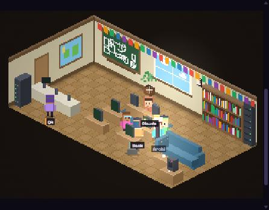
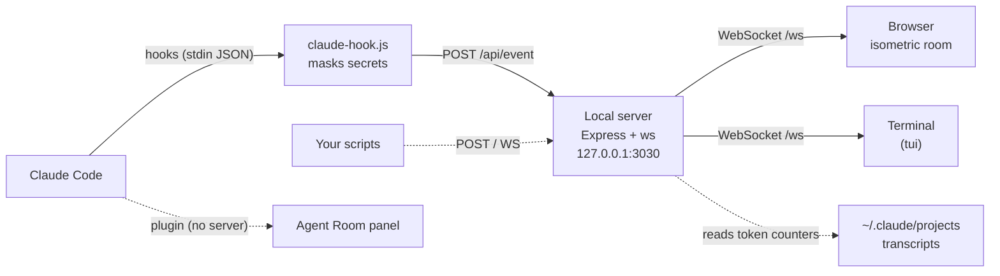

<div align="center">



<br>

[](https://github.com/MehenniIslam/claude-agent-room/actions/workflows/ci.yml)
[](LICENSE)
[](https://nodejs.org)
[](SECURITY.md)
[](#-install)

**English** · [Français](README.fr.md)

[Quick start](#-quick-start) · [Features](#-features) · [Install](#-install) · [Connect Claude Code](#-connect-claude-code) · [Save tokens](#-save-tokens) · [Security](#-security--privacy) · [API](#-event-api)

</div>

---

> Every subagent Claude spawns appears in a beam of light, **walks to the station that matches the tool it's using** (library to read, desks to code, test bench for `Bash`), talks in speech bubbles, then brings its report back to Claude. And then? A coffee break… or retirement by shotgun. 💥

<div align="center">

</div>

## ⚡ Quick start

You need [Node.js](https://nodejs.org) 18.17 or newer (`node -v`). Then, one command:

```bash
npx github:MehenniIslam/claude-agent-room setup
```

The wizard asks four questions (connect Claude Code? suggest token-saving tools? add the token rules to this project? fun or pro mood?) and opens the room at **http://localhost:3030**. Click **▶ demo** to watch a full mission — 5 subagents, a failing test, a fix — without spending a single token.

Every step is reversible: `hooks remove`, `advisor off`, and the mood switches from the page.

> [!TIP]
> The interface speaks **English and French**: it follows your browser's language, and the **Language** menu (or `?lang=en` / `?lang=fr`) switches it.

## ✨ Features

<table>
<tr>
<td width="33%" valign="top">

### 🧊 Isometric room
Walls and furniture in volume, light, shadows. Pixel-art characters walk (A* pathfinding), sit, read, type. Claude wears an orange hoodie with a little spark on top.

</td>
<td width="33%" valign="top">

### 🔔 Get notified
A chime and a desktop notification when Claude **finishes** or **waits for your answer**. Go do something else in the meantime.

</td>
<td width="33%" valign="top">

### 📋 Claude's plan
Its real to-do list, checked off live, with a progress bar — also drawn on the room's whiteboard.

</td>
</tr>
<tr>
<td valign="top">

### 🔍 Diffs
Click any edited file to see exactly which lines were added and removed, and by which agent.

</td>
<td valign="top">

### 💰 Cost & tokens
Tokens and an estimated price for the whole session and for each agent, cache included.

</td>
<td valign="top">

### 💡 Fewer tokens
At the start of a project, Claude offers vetted tools that cut usage — up to **−40 % measured**.

</td>
</tr>
<tr>
<td valign="top">

### 💼 Pro mode
A sober mood for the office or a client demo, an on-disk event log, and JSON/CSV export for audits.

</td>
<td valign="top">

### 💻 Three ways to watch
A **plugin** panel inside Claude Code, a **web page** on a second screen, or **right in your terminal**.

</td>
<td valign="top">

### 🔒 Local & safe
Nothing leaves your machine. API keys and passwords are masked; other websites can't spy on the room.

</td>
</tr>
</table>

Also: 4 worlds, a live agent tree, a filterable log, per-agent detail cards, and guard-rails that keep memory bounded on huge projects and long sessions.

## 📦 Install

| | Best for | How |
|---|---|---|
| 🧩 **Plugin** | Watching inside Claude Code, nothing to run | `/plugin install agent-room --marketplace MehenniIslam/claude-agent-room` |
| 🌐 **Web page** | A big view on a second screen, the full dashboard | `npx github:MehenniIslam/claude-agent-room --open` |
| 🛠️ **From source** | Hacking on it | `git clone` → `npm install` → `npm start` |

<details>
<summary><b>🧩 Plugin details</b></summary>

<br>

The room opens in a panel next to the conversation. No server, no hooks to configure.

 

In a Claude Code session, type:

```
/plugin install agent-room --marketplace MehenniIslam/claude-agent-room
```

Answer `y` to add the marketplace, then pick the "user" scope. From a shell: `claude plugin install agent-room --marketplace MehenniIslam/claude-agent-room`.

In the **desktop app** (where `/plugin` doesn't run): **+** next to the input → **Plugins** → **Add marketplace** with `MehenniIslam/claude-agent-room` → **Add plugin**.

The panel opens on every session (otherwise type `/agent-room`). It shows the room, **what Claude changes** (each file with its `+/−` lines and a colored diff on click), the log, and the **World** and **Ending** menus. In a terminal without images, the panel shows the same as text.

</details>

<details>
<summary><b>🛠️ From source</b></summary>

<br>

```bash
git clone https://github.com/MehenniIslam/claude-agent-room.git
cd claude-agent-room
npm install
npm start            # or: npm run open  (opens the browser)
```

No server at all? Open `public/index.html` directly: the page switches to **demo mode** and plays the simulation locally.

</details>

## 🔌 Connect Claude Code

The web page receives Claude Code's events through [hooks](https://docs.claude.com/en/docs/claude-code/hooks). One command installs them (the `setup` wizard does it for you):

```bash
npx github:MehenniIslam/claude-agent-room hooks install
```

1. Keep the room running.
2. Restart Claude Code, type `/hooks` to check they're there.
3. Give it a task with subagents, e.g. *"Use a subagent to explore the auth code, then another one to write the tests."*

The badge at the top switches to **Live · Claude Code connected** on the first event. Something off? One command checks Node, dependencies, the server and the hooks, and sends a test bubble:

```bash
npx github:MehenniIslam/claude-agent-room doctor
```

<details>
<summary><b>What the install does, exactly</b></summary>

<br>

- copies the hook script to `~/.claude/agent-room/claude-hook.js`, so it keeps working if you move or delete the repo;
- adds 8 hooks to `~/.claude/settings.json`: `PreToolUse`, `PostToolUse`, `SubagentStart`, `SubagentStop`, `UserPromptSubmit`, `Stop`, `SessionStart` (token advisor) and `Notification` ("Claude is waiting");
- **backs up** your `settings.json` first (`settings.json.bak-<date>`), writes atomically, and **keeps your other hooks**;
- can be re-run without creating duplicates.

| Command | Effect |
|---|---|
| `… hooks install --project` | Current project only (`./.claude/settings.json`) |
| `… hooks install --dry-run` | Prints the result without writing anything |
| `… hooks status` | Tells whether the hooks are installed |
| `… hooks remove` | Cleanly removes them (add `--project` if needed) |

The hook **never** blocks Claude: 700 ms max, no output, exit code 0 even when the room is closed. Mute it temporarily with `AGENT_ROOM_DISABLED=1`.

</details>

<details>
<summary><b>No hooks? Follow a transcript instead</b></summary>

<br>

```bash
npx github:MehenniIslam/claude-agent-room watch                       # latest transcript in ~/.claude/projects
npx github:MehenniIslam/claude-agent-room watch ~/.claude/projects/   # a whole folder (subagents included)
```

Only new lines are replayed.

</details>

## 🎮 Using the room

| Area | What it shows |
|---|---|
| **Room** | Claude in the middle, subagents at their stations. Click a character for its detail card. The whiteboard shows Claude's plan. |
| **Hierarchy** | The agent tree, what each one is doing and what it cost. |
| **Log** | Every action, timestamped, filterable (*tools*, *messages*, *errors*), with an **export** button. |
| **Tasks** | Claude's plan: tasks checked live, progress bar, current task. |
| **Files** | Files created ✚, edited ✎ or read ◌, with `+lines −lines`. Click for a colored diff. |
| **Estimated cost** | Top bar: session tokens and price (hover for input / output / cache). |

<details>
<summary><b>🔔 Notifications</b></summary>

<br>

When Claude finishes its turn or waits for you (a permission, a question), the room chimes and shows a toast. If the tab is in the background, its title becomes `(1) Claude is done` and a system notification pops up (your browser asks for permission the first time). The bell, or <kbd>N</kbd>, toggles it. The terminal mode rings the terminal bell.

</details>

<details>
<summary><b>💰 Cost & tokens</b></summary>

<br>

The room reads the token counters Claude Code writes into its transcripts (`~/.claude/projects`) and prices them at **Anthropic's public API rates** (cache included), for the session and for each subagent. It's an **estimate**: on a Claude Pro or Max plan you don't pay per token. Only the counters are read — never the conversation content.

</details>

<details>
<summary><b>💼 Fun or pro mood</b></summary>

<br>

**Mood** menu: in **pro**, no shotgun (finished agents stay on their coffee break) and no small talk in the lounge. The choice is shared by every screen connected to the same server and saved in `~/.claude/agent-room/config.json`. For one specific screen: `http://localhost:3030/?mode=pro`.

</details>

<details>
<summary><b>🗂️ History & export</b></summary>

<br>

Every event is kept on your machine, one file per day in `~/.claude/agent-room/history/` (secrets already masked, 50 MB max per day, 14 days by default). After a restart, the room gets the day's events back. Use the **export** button in the log, or `GET /api/export?day=YYYY-MM-DD&format=csv`. Turn it off with `AGENT_ROOM_HISTORY=0`.

</details>

### ⌨️ Keyboard shortcuts

| Key | Action | | Key | Action |
|:-:|---|---|:-:|---|
| <kbd>D</kbd> | Run the demo | | <kbd>W</kbd> | Next world |
| <kbd>S</kbd> | Spawn a test agent | | <kbd>F</kbd> | Fullscreen |
| <kbd>R</kbd> | Clear the room | | <kbd>N</kbd> | Notifications on / off |
| <kbd>?</kbd> | Help | | <kbd>Esc</kbd> | Close the detail card |

### 🌍 Four worlds

<table>
<tr>
<td align="center"><br><b>💻 Dev studio</b><br><sub>Claude is the Orchestrator</sub></td>
<td align="center"><br><b>🎭 Opera</b><br><sub>Claude is the Conductor</sub></td>
</tr>
<tr>
<td align="center"><br><b>🌻 Garden</b><br><sub>Claude is the Head gardener</sub></td>
<td align="center"><br><b>🏫 Classroom</b><br><sub>Claude is the Teacher</sub></td>
</tr>
</table>

Switch live from the **World** menu or with <kbd>W</kbd>. Direct link: `http://localhost:3030/?world=opera` (`studio`, `opera`, `garden`, `classroom`).

### 💥 Endings: shotgun or coffee break

A subagent that has handed in its report will never be called again. By default the room shows it plainly: after its lounge break, **Claude pulls out a shotgun**. Click-clack, BANG, the agent floats away as a little ghost with a last word. Pure cartoon — stars and a halo, nothing more. If it gets called back before the shot, it's spared. Prefer the gentle version? **Agent ending → ☕ Coffee break** (or `?fin=cafe`), or pro mode.

## 💻 In the terminal

No browser? The room also renders right in your terminal, in color:

```bash
npx github:MehenniIslam/claude-agent-room tui
```

The server starts by itself if needed. You get the floor plan (Claude = ✦, each subagent = its initial, lowercase once done), the agent list, the plan's progress, edited files, the log and the cost — and the terminal rings when Claude finishes or waits.

```
 ✚ Claude Agent Room  ● En direct · Claude Code branché · ~$0.42   q quitter · d démo · r vider · w monde
▀▀▀▀▀▀▀▀▀▀▀▀▀▀▀▀▀▀▀▀▀▀▀▀▀▀▀▀▀▀▀▀▀▀▀▀▀▀▀▀▀▀▀▀▀▀▀▀▀▀▀▀  Agents 3 au travail · 2 en pause
▀▀▀▀▀▀A▀▀▀▀▀▀▀▀▀▀▀▀▀▀▀▀▀▀▀▀▀▀▀▀▀▀▀▀▀▀▀▀▀▀B▀▀▀▀▀▀▀▀▀  ✦ Claude orchestre
▀▀▀▀▀▀▀▀▀▀▀▀▀▀▀▀▀▀▀▀▀▀▀▀▀▀✦▀▀▀▀▀▀▀▀▀▀▀▀▀▀▀▀▀▀▀▀▀▀▀▀  F Front Coder code · Edit
▀▀▀▀▀▀▀▀▀▀▀▀▀▀▀▀▀▀F▀▀▀▀▀▀▀▀▀▀▀▀▀▀▀▀▀▀▀▀▀▀▀▀▀▀▀▀▀▀▀▀  Plan ██████████░░░░░░░░ 3/5
▀▀▀▀Q▀▀▀▀▀▀▀▀▀▀▀▀▀▀▀▀▀▀▀▀▀▀▀▀▀▀▀▀▀▀▀▀▀▀▀▀▀▀▀▀a▀▀b▀▀  ✎ src/pages/Login.tsx Front
```

Keys: <kbd>q</kbd> quit · <kbd>d</kbd> demo · <kbd>r</kbd> clear · <kbd>w</kbd> next world. On an old terminal without 24-bit color, add `--256`. The terminal mode and the CLI messages are in French for now.

## 💡 Save tokens

You start Claude Code and say *"build me a website"*? Before writing the first line, **Claude offers once** to enable tools that cut token usage. You pick; nothing gets installed without your yes.

The shortlist comes from comparing what exists (public benchmarks, reviews, GitHub repos), then reviewing each repo by hand: license, activity, what its hooks and MCP servers run, pinned commit.

| Tool | Best for | Measured gain | Good to know |
|---|---|:-:|---|
| **Token rules** (CLAUDE.md) | every project | **−40 %** | No code runs: bundled text, added between markers in your CLAUDE.md |
| **[Caveman](https://github.com/JuliusBrussee/caveman)** | chatty sessions | **−37 %** | Very terse answers; small local hook at startup |
| **[Context7](https://github.com/upstash/context7)** | sites & apps (React, Next…) | fewer retries | Remote server: receives library names, not your code |
| **[Context Mode](https://github.com/mksglu/context-mode)** | lots of logs / tests | 50–90 % claimed | Runs code in a sandbox; Elastic 2.0 license |
| **[Token Savior](https://github.com/Mibayy/token-savior)** | big typed repos | **−43 %** | Manual install (Python), pinned version |

Gains measured on [computingforgeeks' benchmark](https://computingforgeeks.com/reduce-claude-code-token-usage-tools/) (single task — read them as orders of magnitude). **Rejected** after review: RTK (no independent gain measured, `curl | sh` install), claude-mem (durable storage, no measured gain), alexgreensh/token-optimizer (non-commercial license), claude-context (paid API keys).

```bash
npx github:MehenniIslam/claude-agent-room advisor                  # the list, gains and risks
npx github:MehenniIslam/claude-agent-room advisor check            # has any repo changed since the review?
npx github:MehenniIslam/claude-agent-room advisor apply essentiel  # install rules + Caveman + Context7
npx github:MehenniIslam/claude-agent-room advisor off              # never offer again
```

> [!IMPORTANT]
> **Guard-rails.** Closed list: an unknown tool is refused, even if a file or a web page suggests it to Claude. Before each plugin, the repo is compared with the reviewed commit; if it changed, you see the diff link and get asked again. Never `curl | sh`, `sudo` or API keys. The offer comes once per project — and the cost counter then shows the real effect.

## 🏋️ Built for big projects

<details>
<summary><b>The room never slows Claude down or crashes — here's how</b></summary>

<br>

| Where | Guard-rail |
|---|---|
| Hook | Trims everything large (file contents, `Edit`/`MultiEdit` diffs, command output): each send stays under 200 KB. stdin capped at 16 MB; beyond that the event still goes through (type and tool). Never blocks Claude: 700 ms max, silent. |
| Transcript watcher | Re-lists files every 5 s only, follows transcripts from the last 48 h, reads 4 MB chunks and skips giant lines instead of loading them. |
| Server | 400-event history, bounded subagent memory, generous rate limit (150 events/s), a stalled tab gets disconnected rather than filling memory. |
| Web page | 40 characters max (oldest idle ones leave), 500 tracked files, 400 log lines, detail card redrawn once per frame, pre-rendered furniture. |
| Plugin | At most 6 agents on break in the lounge, so the drawing stays under the panel's size limit. |
| Terminal | 10 frames/s max, only when something moves; 40 agents, 200 log lines, 100 files. |

</details>

## 🔒 Security & privacy

The room sees your prompts, commands and file paths. It's built so they stay with you:

- **100 % local** — the server only listens on `127.0.0.1` and contacts no external service (bundled fonts, no CDN, no telemetry).
- **Other websites are blocked** — a page open in your browser can't read the room (WebSocket), write to it (CSRF), or hijack it via DNS rebinding.
- **Secrets masked** — API keys (Anthropic, OpenAI, AWS, Google, Stripe…), GitHub/GitLab/Slack/npm tokens, JWTs, private keys, passwords in URLs or `password=…` become `[MASQUÉ]` before they even leave the hook.
- **Network = token required** — expose the room (`--host 0.0.0.0`) and a token is generated and enforced.
- **Strict CSP**, no framing, inputs filtered and capped in size and rate; the cost tracker only reads `.jsonl` files under `~/.claude/projects`.

Threat model and how to report a vulnerability: [SECURITY.md](SECURITY.md).

## ⚙️ Configuration

<details>
<summary><b>CLI options and environment variables</b></summary>

<br>

| CLI option | Variable | Default | Role |
|---|---|---|---|
| `--port <n>` | `PORT` or `AGENT_ROOM_PORT` | `3030` | Server port (the hook reads `AGENT_ROOM_PORT`) |
| `--host <ip>` | `HOST` | `127.0.0.1` | Listen address. `0.0.0.0` = local network, token required |
| `--open` | | | Opens the browser on start |
| | `AGENT_ROOM_TOKEN` | *(none locally)* | Token required by the API and WebSocket; set it for the hook too |
| | `AGENT_ROOM_ALLOWED_HOSTS` | | Extra accepted host names, comma-separated |
| | `AGENT_ROOM_URL` | `http://127.0.0.1:3030/api/event` | Hook target |
| | `AGENT_ROOM_TIMEOUT` | `700` | Hook timeout (ms) |
| | `AGENT_ROOM_DISABLED` | | `1` mutes the hook without uninstalling it |
| | `AGENT_ROOM_MODE` | `fun` | `pro`: sober mood (also in `config.json` and the page) |
| | `AGENT_ROOM_HISTORY` | `1` | `0`: no on-disk log |
| | `AGENT_ROOM_RETENTION_DAYS` | `14` | Days of log kept (1–365) |
| | `GITHUB_TOKEN` | | Optional: raises the GitHub API limit for `advisor check` |

Persistent settings live in `~/.claude/agent-room/config.json`. All commands: `npx github:MehenniIslam/claude-agent-room --help`.

</details>

## 🩺 Troubleshooting

<details>
<summary><b>The room stays empty while I use Claude Code</b></summary>

<br>

1. Run `npx github:MehenniIslam/claude-agent-room doctor` — it tells you what's missing.
2. Make sure the room is running **before** you give Claude the task.
3. Restart Claude Code after installing the hooks (they're read at startup), then `/hooks` to see them.
4. Changed the port? Set `AGENT_ROOM_PORT` in Claude Code's environment too.

</details>

<details>
<summary><b>"Port 3030 is already in use"</b></summary>

<br>

If it's already the room, the CLI detects it and just gives you the URL. Otherwise pick another port: `--port 3031`, and `AGENT_ROOM_PORT=3031` for the hook.

</details>

<details>
<summary><b>The badge says "Token required"</b></summary>

<br>

The server was started with a token (or on the network). Open the full URL printed in the terminal — the one ending in `?token=…`.

</details>

<details>
<summary><b>"node" is not recognized / version too old</b></summary>

<br>

Install Node.js LTS from [nodejs.org](https://nodejs.org) (on Windows: `winget install OpenJS.NodeJS.LTS`), then open a **new** terminal.

</details>

<details>
<summary><b>Parallel subagents: a tool is attributed to the wrong agent</b></summary>

<br>

Claude Code doesn't always say which subagent calls a tool. The server uses `agent_id` when present, otherwise the latest active subagent, otherwise Claude. With parallel subagents, attribution can be approximate. The plugin doesn't have this limitation.

</details>

<details>
<summary><b>Uninstall everything</b></summary>

<br>

```bash
npx github:MehenniIslam/claude-agent-room hooks remove
```

Then delete `~/.claude/agent-room/`. For the plugin: `/plugin uninstall agent-room`.

</details>

## 📡 Event API

Drive the room from any script (Anthropic SDK, MCP server, CI…):

```bash
curl -X POST localhost:3030/api/event -H 'content-type: application/json' -d '{
  "type":"SUBAGENT_SPAWN","agentId":"sub-1","role":"Researcher","name":"Scout",
  "message":"map the API routes"}'
curl -X POST localhost:3030/api/event -H 'content-type: application/json' -d '{
  "type":"TOOL_START","agentId":"sub-1","tool":"Grep","message":"grep \"router\" src/"}'
curl -X POST localhost:3030/api/event -H 'content-type: application/json' -d '{
  "type":"SUBAGENT_COMPLETE","agentId":"sub-1","message":"Found 12 routes."}'
```

<details>
<summary><b>Full format and routes</b></summary>

<br>

`POST /api/event` takes an object or an array (200 max), or a raw Claude Code hook payload:

```jsonc
{
  "type": "SUBAGENT_SPAWN | TOOL_START | TOOL_END | AGENT_MESSAGE | SUBAGENT_COMPLETE | ERROR | NOTIFY | RESET",
  "agentId": "subagent-1",            // the orchestrator is "claude-main"
  "parentId": "claude-main",
  "role": "Coder | Researcher | Architect | Tester | Reviewer | Debugger",
  "name": "Agent-Front",
  "tool": "Read | Edit | Bash | Grep | Task",
  "message": "Checking the auth component in src/auth.ts…",
  "targetAgentId": "claude-main",
  "prompt": "Full prompt shown in the detail card (SUBAGENT_SPAWN)",
  "file": "src/auth.ts",
  "success": true,                     // TOOL_END
  "kind": "done | waiting",            // NOTIFY
  "diff": "-old line\n+new line",      // TOOL_START on an edit
  "added": 1, "removed": 1,
  "todos": [{ "content": "Write tests", "status": "pending | in_progress | completed" }]
}
```

Only these fields are kept (others are dropped); text is truncated and secrets are masked.

| Route | Role |
|---|---|
| `POST /api/event` | Send one or more events |
| `POST /api/demo?speed=2` | Run the demo (speed 0.25 to 4) |
| `POST /api/reset` | Clear the room |
| `GET /api/state` | Recent history (400 events) and stats |
| `GET /api/usage` | Tokens and estimated cost, per session and per agent |
| `GET /api/config` · `POST /api/config` | Read / set the shared mood (`{"mode":"pro"}`) |
| `GET /api/history` · `GET /api/export?day=&format=json\|csv` | On-disk log: list days, export one |
| `GET /api/health` | Simple check, no data |
| `WS /ws` | Real-time stream; history is replayed on connect. You can send events too |

With a token: `x-agent-room-token: <token>` header (or `Authorization: Bearer <token>`), and `?token=<token>` for the WebSocket. Browser requests must come from the room's own page. In the browser console, `roomDebug.emit({...})` injects an event locally.

</details>

<details>
<summary><b>How Claude Code payloads are translated</b></summary>

<br>

| Claude Code payload | Room event |
|---|---|
| `PreToolUse` on `Task` / `Agent` | `SUBAGENT_SPAWN` (name from `subagent_type` or `description`, role inferred) |
| `PreToolUse`, other tools | `TOOL_START` (file, command or query summarized; plan and diff when relevant) |
| `PostToolUse` | `TOOL_END` (+ `ERROR` on failure) |
| `PostToolUse` on `Task` / `Agent`, or `SubagentStop` | `SUBAGENT_COMPLETE` with the start of the report |
| `UserPromptSubmit` | Claude announces the new request |
| `Stop` · `Notification` | `NOTIFY` — Claude is done · Claude is waiting for you |

</details>

## 🧱 Architecture



<details>
<summary><b>Repository layout</b></summary>

<br>

```
claude-agent-room/
├── bin/cli.js               # entry point: setup, start, hooks, demo, watch, tui, advisor, doctor
├── server/
│   ├── index.js             # Express + ws: API, demo, real-time broadcast
│   ├── security.js          # host, origin, token, rate limit, headers
│   ├── normalize.js         # Claude Code hook payloads → room events
│   ├── usage.js             # tokens and cost from transcripts
│   ├── history.js           # on-disk log, replay, export
│   └── config.js            # persistent settings
├── bridge/
│   ├── claude-hook.js       # hook stdin → POST (+ masking, token advisor, --jsonl mode)
│   └── setup-hooks.js       # installs / removes the hooks
├── advisor/                 # token advisor: vetted catalog, safe install, bundled rules
├── public/                  # web page: isometric engine, 4 worlds, HUD, translations (i18n.js), fonts
├── tui/                     # the room in the terminal
├── plugin/agent-room/       # Claude Code plugin: SVG panel, file tracking
├── .claude-plugin/          # marketplace (makes the repo installable with /plugin)
└── test/                    # npm test
```

</details>

## 🎨 Make your own world

All worlds share the same layout (stations, obstacles, paths); a world is just some text, a **palette** and a **decor** painted once. Add an object to `public/worlds.js` and register it in `ROOM_WORLDS`:

```js
const spaceship = {
  id: 'spaceship', name: 'Vaisseau spatial', icon: '🚀', claudeTitle: 'Commandant',
  glyphs: ['✦', '01', '◉'],          // particles above the "code" desks
  status: { coding: 'Pilote', reading: 'Scanne', planning: 'Trace la route', bash: 'Teste les moteurs', coffee: 'En cabine' },
  pal: {                              // any missing key falls back to the Studio palette
    floorA: '#2a3140', floorB: '#303848', wallBack: '#1c2230', wallLeft: '#161b26', trim: '#5ef1ff',
    sky: '#05060f', sofa: '#3a4a6a', board: '#0f2a3a', boardInk: '#5ef1ff', night: 'rgba(0,10,30,0.3)'
  },
  decor({ planeS, planeE, floor, rand }) {
    for (const d of [70, 110]) planeE(0, d, 20, 16, 16, '#5ef1ff'); // portholes on the left wall
    floor(140, 120, 40, 4, '#5ef1ff');                               // glowing strip on the floor
  }
};
root.ROOM_WORLDS = { studio, opera, garden, classroom, spaceship };
```

Landmarks (whiteboard, window, desks…) and every drawing helper available in `decor` are documented at the top of `worlds.js`. Furniture, screens and characters follow the palette automatically.

## 🤝 Contributing

```bash
npm install
npm run dev      # server restarts on every change
npm test         # security, masking, hooks, cost, log, advisor, terminal
```

Contributions are welcome — a new world, an agent role, a new language (copy the `en` block in `public/i18n.js`)… Open an issue to discuss, or go straight to a pull request. Report security issues privately (see [SECURITY.md](SECURITY.md)). Release notes: [CHANGELOG.md](CHANGELOG.md).

<details>
<summary><b>Publishing to npm</b></summary>

<br>

So that anyone can type `npx claude-agent-room`: the name is still free. With an npm account, `npm login` then `npm publish` (tests run first thanks to `prepublishOnly`). Then replace `npx github:MehenniIslam/claude-agent-room` with `npx claude-agent-room` in both READMEs, `bin/cli.js`, `server/index.js`, `bridge/claude-hook.js` and `public/index.html`.

</details>

## 📄 License

[MIT](LICENSE). Bundled fonts: [Pixelify Sans](public/fonts/OFL-PixelifySans.txt) and [JetBrains Mono](public/fonts/OFL-JetBrainsMono.txt), under the SIL Open Font License 1.1. Token rules: [drona23/claude-token-efficient](advisor/rules/LICENSE-drona23.txt) (MIT).

<div align="center">
<br>
<sub>Made with ☕, pixels and a lot of subagents.</sub>
</div>
