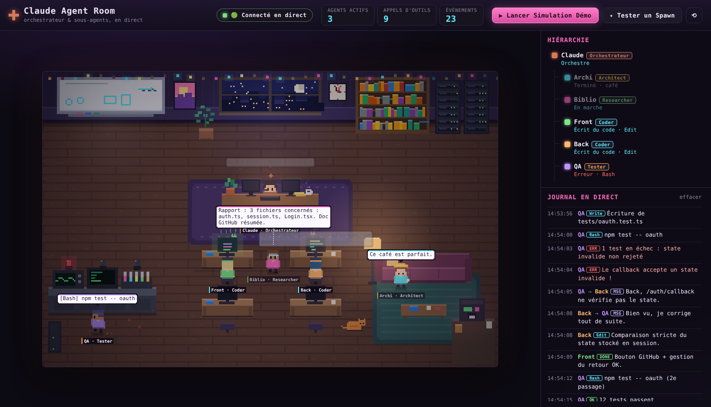
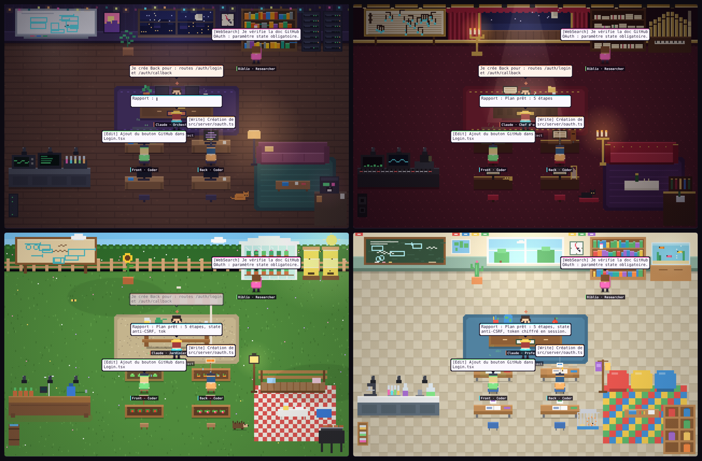
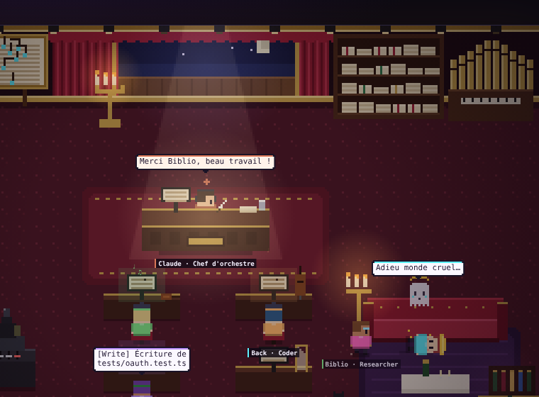

# 🛋️ claude-agent-room



Visualiseur **temps réel** d'un agent Claude orchestrateur et de ses sous-agents, dans une chambre de dev en **pixel art lo-fi**.
Chaque sous-agent apparaît dans un rayon de lumière, marche vers le poste qui correspond à l'outil qu'il utilise, parle dans des bulles, puis revient remettre son rapport à Claude avant d'aller boire un café.

```
┌────────────── Chambre (canvas 320×208, agrandi en pixels nets) ──────────────┐
│ Tableau blanc        Fenêtre    Horloge    Bibliothèque + serveurs RAG       │
│ (Task, TodoWrite)                          (Read, Grep, Glob, WebSearch)     │
│                     Bureau de Claude (2 écrans, plante, café)               │
│ Banc de test          Îlot de code (4 bureaux)          Coin canapé + café   │
│ (Bash, voyants)       (Write, Edit, MultiEdit)          (terminé / en pause) │
└──────────────────────────────────────────────────────────────────────────────┘
```

## 4 mondes au choix



Choisis le décor dans la barre du haut (menu **Monde**). Le changement est instantané, même en pleine mission, et ton choix est mémorisé.

| Monde | Claude est… | Planifier | Lire / chercher | Coder | Tester (Bash) | Pause |
|---|---|---|---|---|---|---|
| 💻 Studio dev | Orchestrateur | tableau blanc | bibliothèque + serveurs | 4 bureaux dev | banc de test | canapé + café |
| 🎭 Opéra | Chef d'orchestre | grande partition | partitions + orgue | pupitres des musiciens | régie son & lumière | loge VIP |
| 🌻 Jardin | Jardinier en chef | plan du potager | serre + ruches | carrés potagers | établi d'arrosage | barbecue |
| 🏫 Salle de classe | Professeur | tableau noir | bibliothèque + aquarium | pupitres d'élèves | paillasse de sciences | coin récré |

Lien direct vers un monde : `http://localhost:3030/?world=opera` (`studio`, `opera`, `garden`, `classroom`).

## Fin des agents : à la pompe 💥 ou pause café ☕

Un sous-agent Claude Code qui a rendu son rapport ne sera plus jamais rappelé. Par défaut, la chambre le montre sans détour : après sa pause au canapé, **Claude sort un fusil à pompe**. Clic-clac, BANG, l'agent est projeté K.O. puis s'envole en petit fantôme qui lâche une dernière réplique. C'est du pur cartoon : pas de sang, juste des étoiles et un halo.



- S'il est rappelé avant le tir (nouvel appel d'outil), il est épargné et retourne au travail.
- Préfère la version douce ? Choisis **☕ Pause café** dans le menu *Fin des agents* (ou `?fin=cafe`) : les agents terminés restent au canapé.

## Démarrage (30 secondes)

Prérequis : [Node.js](https://nodejs.org) 18 ou plus récent.

```bash
git clone https://github.com/MehenniIslam/claude-agent-room.git
cd claude-agent-room
npm install
npm start
```

Ouvre **http://localhost:3030** puis clique sur **▶ Lancer Simulation Démo** (ou `curl -X POST http://localhost:3030/api/demo`).
La démo rejoue une mission complète (OAuth GitHub) avec 5 sous-agents, un test en échec, une correction et les rapports finaux. Aucun token consommé.

> Pas de serveur ? Ouvre directement `public/index.html` : l'interface passe en **🟠 Mode Démo** et lance la simulation localement.

## Brancher Claude Code en direct

```bash
npm start                      # 1. le serveur doit tourner
npm run hooks:install          # 2. ajoute les hooks dans ~/.claude/settings.json
# ou, pour un seul projet :
cd mon-projet && node /chemin/vers/claude-agent-room/bridge/setup-hooks.js --project
```

Relance Claude Code (tape `/hooks` pour vérifier), puis donne-lui une tâche qui utilise des sous-agents, par exemple :
*« Utilise un sous-agent pour explorer le code d'authentification, puis un autre pour écrire les tests. »*

Le script d'installation :
- sauvegarde ton `settings.json` (`settings.json.bak-<date>`) avant toute modification ;
- conserve tes hooks existants et peut être relancé sans créer de doublons ;
- se retire proprement avec `npm run hooks:remove` (ajoute `--project` si tu l'as installé par projet) ;
- s'essaie à blanc avec `node bridge/setup-hooks.js --dry-run`.

Configuration ajoutée (équivalent manuel) :

```json
{
  "hooks": {
    "PreToolUse":       [{ "matcher": "*", "hooks": [{ "type": "command", "command": "node \"/chemin/claude-agent-room/bridge/claude-hook.js\"", "timeout": 5 }] }],
    "PostToolUse":      [{ "matcher": "*", "hooks": [{ "type": "command", "command": "node \"/chemin/claude-agent-room/bridge/claude-hook.js\"", "timeout": 5 }] }],
    "SubagentStart":    [{ "hooks": [{ "type": "command", "command": "node \"/chemin/claude-agent-room/bridge/claude-hook.js\"", "timeout": 5 }] }],
    "SubagentStop":     [{ "hooks": [{ "type": "command", "command": "node \"/chemin/claude-agent-room/bridge/claude-hook.js\"", "timeout": 5 }] }],
    "UserPromptSubmit": [{ "hooks": [{ "type": "command", "command": "node \"/chemin/claude-agent-room/bridge/claude-hook.js\"", "timeout": 5 }] }],
    "Stop":             [{ "hooks": [{ "type": "command", "command": "node \"/chemin/claude-agent-room/bridge/claude-hook.js\"", "timeout": 5 }] }]
  }
}
```

Si ta version de Claude Code ne connaît pas `SubagentStart`, retire simplement cette entrée : la chambre fonctionne sans.

### Comment le pont fonctionne

`bridge/claude-hook.js` lit le JSON que Claude Code écrit sur stdin et le transmet tel quel à `POST /api/event`. Le serveur (`server/normalize.js`) le traduit :

| Payload Claude Code | Événement chambre |
|---|---|
| `PreToolUse` sur `Task` / `Agent` | `SUBAGENT_SPAWN` (nom tiré de `subagent_type` ou `description`, rôle déduit) |
| `PreToolUse` autre outil | `TOOL_START` (fichier, commande ou requête résumés) |
| `PostToolUse` | `TOOL_END` (+ `ERROR` si échec) |
| `PostToolUse` sur `Task` / `Agent`, ou `SubagentStop` | `SUBAGENT_COMPLETE` avec le début du rapport |
| `UserPromptSubmit` | Claude annonce la nouvelle demande |

Garanties : le hook ne bloque jamais Claude (délai max 700 ms, aucune sortie, code 0 même serveur éteint) et tronque les réponses volumineuses.

**Attribution des outils** : Claude Code n'indique pas toujours quel sous-agent appelle un outil. Le serveur utilise `agent_id` quand il est présent, sinon le dernier sous-agent encore actif, sinon Claude. Avec plusieurs sous-agents en parallèle, l'attribution peut donc être approximative.

### Alternative sans hooks : suivre un transcript

```bash
npm run watch:transcript                                 # le transcript le plus récent de ~/.claude/projects
node bridge/claude-hook.js --jsonl ~/.claude/projects/   # tout un dossier (sous-agents inclus)
```

Seules les nouvelles lignes sont rejouées.

## Protocole d'événements

`POST http://localhost:3030/api/event` (un objet ou un tableau) :

```json
{
  "timestamp": 1730000000000,
  "type": "SUBAGENT_SPAWN | TOOL_START | AGENT_MESSAGE | SUBAGENT_COMPLETE | ERROR",
  "agentId": "subagent-1",
  "parentId": "claude-main",
  "role": "Coder | Researcher | Architect | Tester",
  "name": "Agent-Front",
  "tool": "Read | Edit | Bash | Grep | Task",
  "message": "Je vérifie le composant d'authentification dans src/auth.ts...",
  "targetAgentId": "claude-main"
}
```

Champs facultatifs supplémentaires :

| Champ | Utilisé par | Effet |
|---|---|---|
| `prompt` | `SUBAGENT_SPAWN` | Prompt complet affiché dans la fiche de l'agent |
| `file` | `TOOL_START` | Ajouté aux « fichiers touchés » (les chemins dans `message` sont aussi détectés) |
| `type: "TOOL_END"` + `success` | fin d'outil | Voyant vert / rouge sur le banc de test |

Rôles reconnus (accessoire et couleur dédiés) : `Coder`, `Researcher`, `Architect`, `Tester`, `Reviewer`, `Debugger`. L'orchestrateur a l'identifiant `claude-main`.

Exemple :

```bash
curl -X POST localhost:3030/api/event -H 'content-type: application/json' -d '{
  "type":"SUBAGENT_SPAWN","agentId":"sub-1","role":"Researcher","name":"Scout",
  "message":"cartographier les routes API"}'
curl -X POST localhost:3030/api/event -H 'content-type: application/json' -d '{
  "type":"TOOL_START","agentId":"sub-1","tool":"Grep","message":"grep \"router\" src/"}'
curl -X POST localhost:3030/api/event -H 'content-type: application/json' -d '{
  "type":"SUBAGENT_COMPLETE","agentId":"sub-1","message":"12 routes trouvées."}'
```

Depuis un script Python ou TypeScript (Anthropic SDK, serveur MCP…), il suffit d'envoyer ces mêmes objets en POST, ou directement par WebSocket sur `ws://localhost:3030/ws`.

### Autres routes

| Route | Rôle |
|---|---|
| `POST /api/demo?speed=2` | Lance la démo (vitesse 0.25 à 4) |
| `POST /api/reset` | Vide la chambre |
| `GET /api/state` | Historique récent (400 événements) et nombre de clients |
| `GET /api/health` | Vérification simple |
| `WS /ws` | Flux temps réel ; à la connexion, l'historique est rejoué instantanément |

## Ce que tu vois

- **Spawn** : rayon lumineux près du bureau, Claude annonce « Je crée X pour : … », l'agent répond « Bien reçu chef, je m'en occupe ! ».
- **Déplacements** : pathfinding A* sur grille avec lissage, marche rebondissante et poussière.
- **Postes** : écrans qui s'allument et particules de code à l'îlot, schémas qui se dessinent au tableau, livres tirés des étagères, voyants orange / vert / rouge au banc de test.
- **Bulles** : effet machine à écrire, 4 s de lecture, empilement sans chevauchement, bulles rouges pour les erreurs.
- **Fin de mission** : l'agent apporte un dossier à Claude (animation), lit son rapport, puis part au canapé, où les agents au repos discutent entre eux… jusqu'à leur retraite à la pompe (ou pas, en mode pause café).
- **HUD** : statut WebSocket, compteurs, arbre hiérarchique en direct, journal horodaté, fiche détaillée au clic (prompt initial, fichiers touchés, historique).

## Structure

```
claude-agent-room/
├── package.json
├── server/
│   ├── index.js          # Express + ws : /api/event, /api/demo, /ws
│   └── normalize.js      # payloads Hooks Claude Code → événements chambre
├── bridge/
│   ├── claude-hook.js    # hook stdin → POST (et mode --jsonl)
│   └── setup-hooks.js    # installe / retire les hooks
└── public/
    ├── index.html        # HUD
    ├── style.css
    ├── app.js            # moteur pixel art, monde Studio, animations, bulles, client WebSocket
    ├── worlds.js         # mondes Opéra, Jardin, Salle de classe
    └── demo-scenario.js  # scénario partagé serveur / navigateur
```

## Ajouter ton propre monde

Tous les mondes partagent la même disposition (postes, obstacles, chemins). Un monde ne fait que redessiner le décor par-dessus. Pour en créer un, ajoute une fonction dans `public/worlds.js` et enregistre-la dans `ROOM_WORLDS` :

```js
function spaceship(api) {
  const { px, g } = api;            // px(contexte, x, y, largeur, hauteur, couleur)
  return {
    id: 'spaceship', name: 'Vaisseau spatial', icon: '🚀', claudeTitle: 'Commandant',
    glyphs: ['✦', '01', '◉'],       // particules au poste "code"
    status: { coding: 'Pilote', reading: 'Scanne', planning: 'Trace la route', bash: 'Teste les moteurs', coffee: 'En cabine' },
    background(c, rand) { /* sol, murs, meubles fixes (dessinés une seule fois) */ },
    top(t) { /* animations du mur : étoiles, écrans… */ },
    board(t, strokes) { api.drawStrokes(strokes, t); },
    props(t) { return [ /* { y: ligne de base, draw: () => … } triés avec les personnages */ ]; },
    lighting(t) { api.vignette(0.4); }
  };
}
root.ROOM_WORLDS = { opera, garden, classroom, spaceship };
```

Les emplacements à respecter sont listés en tête de `worlds.js`. L'objet `api` donne aussi l'état de la chambre : `codeUser(i)`, `readers()`, `benchRunning()`, `mainActive()`, `deskPile()`, etc.

## Réglages

| Variable | Défaut | Rôle |
|---|---|---|
| `PORT` | `3030` | Port du serveur |
| `HOST` | `127.0.0.1` | Interface d'écoute (`0.0.0.0` pour l'exposer sur le réseau local) |
| `AGENT_ROOM_URL` | `http://localhost:3030/api/event` | Cible du hook |
| `AGENT_ROOM_TIMEOUT` | `700` | Délai max du hook (ms) |

Dans la console du navigateur, `roomDebug.emit({...})` injecte un événement localement.

Licence [MIT](LICENSE).
