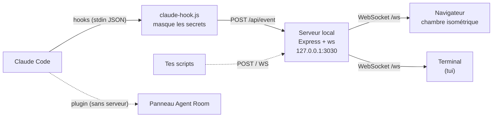

<div align="center">

# 🛋️ claude-agent-room

**Regarde Claude et ses sous-agents travailler, en direct, dans une chambre en pixel art.**

[](https://github.com/MehenniIslam/claude-agent-room/actions/workflows/ci.yml)
[](LICENSE)
[](https://nodejs.org)
[](SECURITY.md)


[Installation](#-installation) · [Brancher Claude Code](#-brancher-claude-code) · [Utilisation](#-utilisation) · [Terminal](#-dans-le-terminal) · [Tokens](#-économiser-des-tokens) · [Gros projets](#-gros-projets) · [Sécurité](#-sécurité-et-confidentialité) · [Dépannage](#-dépannage) · [API](#-protocole-dévénements)

</div>

---

Chaque sous-agent que Claude crée apparaît dans un rayon de lumière, **marche vers le poste qui correspond à l'outil qu'il utilise** (bibliothèque pour lire, bureaux pour coder, banc de test pour `Bash`…), parle dans des bulles, puis revient remettre son rapport à Claude. Ensuite ? Pause café… ou retraite à la pompe. 💥

## ✨ Ce que tu obtiens

- 🧊 **Une chambre en 3D isométrique** : murs et meubles en volume, ombres, lumière, personnages en pixel art qui marchent (pathfinding A*), s'assoient, lisent, tapent du code. Claude porte son sweat orange et une petite étincelle au-dessus de la tête.
- 🌍 **4 mondes** : Studio dev, Opéra, Jardin, Salle de classe, changeables en pleine mission.
- 🗂️ **Le suivi des fichiers** : tout ce que les agents créent ✚, modifient ✎ ou lisent ◌, avec l'auteur.
- 🧭 **Le contexte complet** : arbre des agents, journal filtrable, fiche détaillée (prompt initial, historique) au clic.
- 🔔 **Prévenu au bon moment** : son et notification quand Claude a fini ou attend ta réponse — tu peux faire autre chose pendant qu'il travaille.
- 📋 **Le plan de Claude** : sa vraie liste de tâches, cochée en direct, avec une barre de progression (et sur le tableau de la chambre).
- 🔍 **Les diffs** : clique sur un fichier modifié pour voir exactement les lignes ajoutées et retirées.
- 💰 **Le coût** : tokens et prix estimé, pour toute la session et par agent.
- 💡 **Moins de tokens** : au début d'un projet, Claude te propose des outils vérifiés qui réduisent la consommation (jusqu'à −40 % mesurés).
- 💼 **Mode pro** : ambiance sobre pour le bureau ou une démo client, journal sur disque et export JSON/CSV pour l'audit.
- 🔌 **Trois façons de l'utiliser** : en **plugin** dans un panneau de Claude Code, en **page web** sur un deuxième écran, ou **directement dans le terminal**.
- 🏋️ **Tient la charge** : pensé pour les gros projets et les longues sessions (mémoire bornée partout, rien qui grossit sans fin).
- 🔒 **Local et sûr** : aucune donnée ne quitte ta machine, les clés API et mots de passe sont masqués, les autres sites ne peuvent pas espionner la chambre.

## 🚀 Installation

### Le plus rapide : une seule commande

Prérequis : [Node.js](https://nodejs.org) 18.17 ou plus récent (`node -v` pour vérifier).

```bash
npx github:MehenniIslam/claude-agent-room setup
```

L'assistant te pose 4 questions (brancher Claude Code, proposer les outils d'économie de tokens, ajouter les règles d'économie au projet, ambiance fun ou pro), puis ouvre la chambre. Chaque étape se défait : `hooks remove`, `advisor off`, et l'ambiance se change dans la page.

Sinon, trois options à la carte, de la plus simple à la plus complète.

### Option 1 — Le plugin Claude Code (rien à lancer)

La chambre s'ouvre dans un panneau à côté de la conversation. Pas de serveur, pas de hooks à configurer.

 

Dans une session Claude Code (terminal), tape :

```
/plugin install agent-room --marketplace MehenniIslam/claude-agent-room
```

Réponds `y` pour ajouter le marketplace, puis choisis la portée « user » avec Entrée. Depuis un shell, c'est la même chose :

```bash
claude plugin install agent-room --marketplace MehenniIslam/claude-agent-room
```

Dans l'**app de bureau** (où `/plugin` ne s'exécute pas) : **+** à côté de la zone de saisie → **Plugins** → **Add marketplace** avec `MehenniIslam/claude-agent-room` → **Add plugin**.

Le panneau s'ouvre tout seul à chaque session (sinon tape `/agent-room`). Il montre la chambre, **« Ce que Claude modifie »** (chaque fichier avec ses lignes `+/−` et un diff coloré au clic), le journal, et les menus **Monde** et **Fin**. Dans un terminal sans images, le panneau affiche la même chose en texte.

### Option 2 — La page web en une commande

Prérequis : [Node.js](https://nodejs.org) 18.17 ou plus récent (`node -v` pour vérifier).

```bash
npx github:MehenniIslam/claude-agent-room --open
```

La chambre s'ouvre sur **http://localhost:3030**. Clique sur **▶ Lancer la démo** pour voir une mission complète (5 sous-agents, un test qui casse, une correction) — aucun token consommé. Pour voir tes vrais agents, passe à [Brancher Claude Code](#-brancher-claude-code).

### Option 3 — Depuis le code source

```bash
git clone https://github.com/MehenniIslam/claude-agent-room.git
cd claude-agent-room
npm install
npm start            # ou : npm run open  (ouvre le navigateur)
```

> 💡 Pas de serveur du tout ? Ouvre directement `public/index.html` : la page passe en **Mode démo** et joue la simulation localement.

## 🔌 Brancher Claude Code

La page web reçoit les événements de Claude Code grâce à des [hooks](https://docs.claude.com/en/docs/claude-code/hooks). Une commande les installe :

```bash
npx github:MehenniIslam/claude-agent-room hooks install
```

(ou `npm run hooks:install` depuis le dossier cloné). Ensuite :

1. Laisse la chambre tourner (option 2 ou 3 ci-dessus).
2. Relance Claude Code, et tape `/hooks` pour vérifier que les hooks sont là.
3. Donne-lui une tâche avec des sous-agents, par exemple :
   *« Utilise un sous-agent pour explorer le code d'authentification, puis un autre pour écrire les tests. »*

Le badge en haut de la page passe à **En direct · Claude Code branché** dès le premier événement.

**Vérifier que tout marche** — une seule commande contrôle Node, les dépendances, le serveur, les hooks, et envoie une bulle de test :

```bash
npx github:MehenniIslam/claude-agent-room doctor
```

<details>
<summary><b>Ce que fait l'installation, exactement</b></summary>

- copie le script du hook dans `~/.claude/agent-room/claude-hook.js` : il continue de marcher même si tu déplaces ou supprimes le dépôt ;
- ajoute 6 hooks (`PreToolUse`, `PostToolUse`, `SubagentStart`, `SubagentStop`, `UserPromptSubmit`, `Stop`) dans `~/.claude/settings.json` ;
- **sauvegarde** d'abord ton `settings.json` (`settings.json.bak-<date>`), écrit de façon atomique et **conserve tes autres hooks** ;
- peut être relancée sans créer de doublons.

Variantes :

| Commande | Effet |
|---|---|
| `… hooks install --project` | Installe pour le projet courant seulement (`./.claude/settings.json`) |
| `… hooks install --dry-run` | Affiche le résultat sans rien écrire |
| `… hooks status` | Indique si les hooks sont installés |
| `… hooks remove` | Retire proprement les hooks (ajoute `--project` si besoin) |

Le hook ne bloque **jamais** Claude : délai max 700 ms, aucune sortie, code de sortie 0 même si la chambre est fermée. Pour le couper temporairement : `AGENT_ROOM_DISABLED=1`.

Si ta version de Claude Code ne connaît pas `SubagentStart`, ce n'est pas grave : la chambre fonctionne sans.
</details>

<details>
<summary><b>Alternative sans hooks : suivre un transcript</b></summary>

```bash
npx github:MehenniIslam/claude-agent-room watch                       # le transcript le plus récent de ~/.claude/projects
npx github:MehenniIslam/claude-agent-room watch ~/.claude/projects/   # tout un dossier (sous-agents inclus)
```

Seules les nouvelles lignes sont rejouées.
</details>

## 🎮 Utilisation

### L'interface

| Zone | Ce qu'elle montre |
|---|---|
| **Chambre** | Claude au centre, les sous-agents à leur poste. Clique sur un personnage pour ouvrir sa fiche. Le tableau affiche le plan de Claude. |
| **Hiérarchie** | L'arbre des agents, ce que chacun fait et ce qu'il a coûté. |
| **Journal** | Chaque action horodatée, filtrable : *Outils*, *Messages*, *Erreurs*. Bouton **exporter** (JSON ou CSV). |
| **Tâches** | Le plan de Claude : tâches cochées en direct, barre de progression, tâche en cours. |
| **Fichiers** | Les fichiers créés ✚, modifiés ✎ ou lus ◌, avec `+lignes −lignes`. Clic = diff coloré. |
| **Coût estimé** | En haut : tokens et prix de la session (survol pour le détail entrée / sortie / cache). |

### Être prévenu 🔔

Quand Claude a fini son tour ou attend ta réponse (une permission, une question), la chambre joue un petit son et affiche une notification. Si l'onglet est en arrière-plan, son titre indique `(1) Claude a fini` et une notification système apparaît (le navigateur te demande l'autorisation la première fois). La cloche en haut, ou <kbd>N</kbd>, coupe ou réactive. Le mode terminal fait sonner le terminal.

### Coût et tokens 💰

La chambre lit les compteurs de tokens que Claude Code écrit dans ses transcripts (`~/.claude/projects`) et calcule un prix au **tarif public de l'API Anthropic** (cache compris), pour la session et pour chaque sous-agent. C'est une **estimation** : avec un abonnement Claude Pro ou Max, tu ne paies pas au token. Seuls les compteurs sont lus, jamais le contenu des conversations.

### Ambiance fun ou pro 💼

Menu **Ambiance** : en **pro**, pas de fusil à pompe (les agents terminés restent en pause café), pas de blagues au salon. Le choix est partagé par tous les écrans branchés sur le même serveur et mémorisé (`~/.claude/agent-room/config.json`). Pour un écran précis : `http://localhost:3030/?mode=pro`.

### Historique et export 🗂️

Tous les événements sont gardés sur ta machine, un fichier par jour dans `~/.claude/agent-room/history/` (secrets déjà masqués, 50 Mo max par jour, 14 jours par défaut). Au redémarrage, la chambre retrouve les événements du jour. Bouton **exporter** dans le journal, ou `GET /api/export?day=AAAA-MM-JJ&format=csv`. Pour couper : `AGENT_ROOM_HISTORY=0`.

### Raccourcis clavier

| Touche | Action | | Touche | Action |
|:-:|---|---|:-:|---|
| <kbd>D</kbd> | Lancer la démo | | <kbd>W</kbd> | Monde suivant |
| <kbd>S</kbd> | Faire apparaître un agent de test | | <kbd>F</kbd> | Plein écran |
| <kbd>R</kbd> | Vider la chambre | | <kbd>N</kbd> | Notifications oui / non |
| <kbd>?</kbd> | Aide | | | |

### 4 mondes au choix

  

| Monde | Claude est… | Planifier | Lire / chercher | Coder | Tester (Bash) | Pause |
|---|---|---|---|---|---|---|
| 💻 Studio dev | Orchestrateur | tableau blanc | bibliothèque + serveurs | 4 bureaux dev | banc de test | canapé + café |
| 🎭 Opéra | Chef d'orchestre | grande partition | partitions + orgue | pupitres des musiciens | régie son | loge en velours |
| 🌻 Jardin | Jardinier en chef | plan du potager | serre + ruche | établis | établi d'arrosage | transats |
| 🏫 Salle de classe | Professeur | tableau noir à la craie | bibliothèque | pupitres d'élèves | paillasse de sciences | coin lecture |

Le choix est mémorisé. Lien direct : `http://localhost:3030/?world=opera` (`studio`, `opera`, `garden`, `classroom`).

### Fin des agents : à la pompe 💥 ou pause café ☕

Un sous-agent qui a rendu son rapport ne sera plus jamais rappelé. Par défaut, la chambre le montre sans détour : après sa pause au canapé, **Claude sort un fusil à pompe**. Clic-clac, BANG, l'agent part en petit fantôme avec une dernière réplique. Pur cartoon : des étoiles et un halo, rien de plus.

S'il est rappelé avant le tir, il est épargné. Préfère la version douce ? Menu **Fin des agents → ☕ Pause café** (ou `?fin=cafe`).

## 💻 Dans le terminal

Pas envie d'ouvrir un navigateur ? La chambre s'affiche aussi directement dans le terminal, en couleurs :

```bash
npx github:MehenniIslam/claude-agent-room tui
```

Le serveur démarre tout seul s'il ne tourne pas déjà. Tu vois le plan de la chambre (Claude = ✦, chaque sous-agent = son initiale, en minuscule quand il a fini), la liste des agents, les fichiers modifiés et le journal :

```
 ✚ Claude Agent Room  ● En direct · Claude Code branché   q quitter · d démo · r vider · w monde
▀▀▀▀▀▀▀▀▀▀▀▀▀▀▀▀▀▀▀▀▀▀▀▀▀▀▀▀▀▀▀▀▀▀▀▀▀▀▀▀▀▀▀▀▀▀▀▀▀▀▀▀  Agents 3 au travail · 2 en pause
▀▀▀▀▀▀A▀▀▀▀▀▀▀▀▀▀▀▀▀▀▀▀▀▀▀▀▀▀▀▀▀▀▀▀▀▀▀▀▀▀B▀▀▀▀▀▀▀▀▀  ✦ Claude orchestre
▀▀▀▀▀▀▀▀▀▀▀▀▀▀▀▀▀▀▀▀▀▀▀▀▀▀✦▀▀▀▀▀▀▀▀▀▀▀▀▀▀▀▀▀▀▀▀▀▀▀▀  F Front Coder code · Edit
▀▀▀▀▀▀▀▀▀▀▀▀▀▀▀▀▀▀F▀▀▀▀▀▀▀▀▀▀▀▀▀▀▀▀▀▀▀▀▀▀▀▀▀▀▀▀▀▀▀▀  Q QA Tester teste · Bash
▀▀▀▀Q▀▀▀▀▀▀▀▀▀▀▀▀▀▀▀▀▀▀▀▀▀▀▀▀▀▀▀▀▀▀▀▀▀▀▀▀▀▀▀▀a▀▀b▀▀  Fichiers modifiés
                                                    ✎ src/pages/Login.tsx Front
```

Touches : <kbd>q</kbd> quitter · <kbd>d</kbd> démo · <kbd>r</kbd> vider · <kbd>w</kbd> monde suivant. Sur un terminal ancien sans couleurs 24 bits, ajoute `--256`. Le terminal sonne quand Claude a fini ou attend ta réponse, et le panneau montre l'avancement du plan et le coût.

## 💡 Économiser des tokens

Tu lances Claude Code et tu lui dis « crée-moi un site » ? Avant d'écrire la première ligne, **Claude te propose une fois** d'activer des outils qui réduisent la consommation de tokens. Tu choisis lesquels ; rien ne s'installe sans ton accord.

La sélection vient d'une comparaison des outils existants (bancs d'essai publics, avis, dépôts GitHub), puis d'une vérification à la main de chaque dépôt : licence, activité, contenu des hooks et des serveurs MCP, commit relu.

| Outil | Pour | Gain mesuré | À savoir |
|---|---|---|---|
| **Règles d'économie** (CLAUDE.md) | tous les projets | −40 % | Aucun code exécuté : texte embarqué, ajouté entre balises dans ton CLAUDE.md |
| **[Caveman](https://github.com/JuliusBrussee/caveman)** | sessions bavardes | −37 à −38 % | Réponses très laconiques ; hook local au démarrage |
| **[Context7](https://github.com/upstash/context7)** | sites et apps (React, Next…) | moins de corrections | Serveur distant : reçoit les noms de bibliothèques, pas ton code |
| **[Context Mode](https://github.com/mksglu/context-mode)** | beaucoup de logs / tests | 50–90 % annoncés | Exécute du code en bac à sable ; licence Elastic 2.0 |
| **[Token Savior](https://github.com/Mibayy/token-savior)** | gros dépôts typés | −43 % | Installation manuelle (Python), version épinglée |

Gains mesurés sur le banc d'essai de [computingforgeeks](https://computingforgeeks.com/reduce-claude-code-token-usage-tools/) (une tâche, à prendre comme ordre de grandeur). **Écartés** après vérification : RTK (aucun gain mesuré indépendamment, installation `curl | sh`), claude-mem (stockage durable, pas de gain chiffré), alexgreensh/token-optimizer (licence non commerciale), claude-context (clés payantes).

```bash
npx github:MehenniIslam/claude-agent-room advisor                  # la liste, les gains, les risques
npx github:MehenniIslam/claude-agent-room advisor check            # chaque dépôt a-t-il changé depuis la vérification ?
npx github:MehenniIslam/claude-agent-room advisor apply essentiel  # installer règles + Caveman + Context7
npx github:MehenniIslam/claude-agent-room advisor off              # ne plus jamais proposer
```

**Garde-fous** : liste fermée (un outil inconnu est refusé, même si un fichier ou une page le suggère à Claude) ; avant chaque plugin, le dépôt est comparé au commit relu et, s'il a changé, tu vois le lien des différences et on te redemande ; jamais de `curl | sh`, de `sudo` ni de clé API ; la proposition n'arrive qu'une fois par projet. La chambre mesure ensuite l'effet réel dans le compteur de coût.

## 🏋️ Gros projets

La chambre est conçue pour ne jamais ralentir Claude ni planter, même sur un gros dépôt avec des dizaines de sous-agents et des heures de session :

| Où | Garde-fou |
|---|---|
| Hook | Tronque tout ce qui est gros (contenu de fichiers, diffs d'`Edit`/`MultiEdit`, sorties de commandes) : chaque envoi fait moins de 200 Ko. stdin limité à 16 Mo ; au-delà, l'événement est quand même transmis (type et outil). Ne bloque jamais Claude : 700 ms max, sortie silencieuse. |
| Suivi de transcript (`watch`) | Relit la liste des fichiers toutes les 5 s seulement, ne suit que les transcripts des 48 dernières heures, lit par morceaux de 4 Mo et saute les lignes géantes au lieu de les charger. |
| Serveur | Historique de 400 événements, sous-agents mémorisés bornés, limite de débit généreuse (150 événements/s), onglet trop lent déconnecté plutôt que de saturer la mémoire. |
| Page web | 40 personnages au plus dans la chambre (les plus anciens au repos s'en vont), 500 fichiers suivis, journal de 400 lignes, fiche redessinée une fois par image. Meubles pré-rendus : seule la scène est redessinée à chaque image. |
| Plugin | Au plus 6 agents en pause dans le salon, pour que le dessin reste sous la limite de taille du panneau. |
| Terminal | 10 images/s au plus, seulement quand quelque chose bouge ; 40 agents, 200 lignes de journal, 100 fichiers. |

## 🔒 Sécurité et confidentialité

La chambre voit passer tes prompts, tes commandes et tes chemins de fichiers. Elle est conçue pour que ça reste chez toi :

- **100 % local** : le serveur écoute uniquement `127.0.0.1`, ne contacte aucun service externe (polices embarquées, pas de CDN, pas de télémétrie).
- **Les autres sites sont bloqués** : une page web ouverte dans ton navigateur ne peut ni lire la chambre (WebSocket), ni y écrire (CSRF), ni la détourner par DNS rebinding.
- **Secrets masqués** : clés API (Anthropic, OpenAI, AWS, Google, Stripe…), tokens GitHub/GitLab/Slack/npm, JWT, clés privées, mots de passe dans une URL ou en `password=…` deviennent `[MASQUÉ]` avant même de quitter le hook.
- **Réseau = jeton obligatoire** : si tu exposes la chambre (`--host 0.0.0.0`), un jeton est exigé et généré automatiquement.
- **CSP stricte**, anti-iframe, entrées filtrées et limitées en taille et en débit.

Détails, modèle de menace et signalement de faille : [SECURITY.md](SECURITY.md).

## ⚙️ Configuration

| Option CLI | Variable | Défaut | Rôle |
|---|---|---|---|
| `--port <n>` | `PORT` ou `AGENT_ROOM_PORT` | `3030` | Port du serveur (le hook lit `AGENT_ROOM_PORT`) |
| `--host <ip>` | `HOST` | `127.0.0.1` | Interface d'écoute. `0.0.0.0` = réseau local, jeton exigé |
| `--open` | | | Ouvre le navigateur au démarrage |
| | `AGENT_ROOM_TOKEN` | *(aucun en local)* | Jeton exigé par l'API et le WebSocket ; à définir aussi côté hook |
| | `AGENT_ROOM_ALLOWED_HOSTS` | | Noms d'hôte supplémentaires acceptés, séparés par des virgules |
| | `AGENT_ROOM_URL` | `http://127.0.0.1:3030/api/event` | Cible du hook |
| | `AGENT_ROOM_TIMEOUT` | `700` | Délai max du hook (ms) |
| | `AGENT_ROOM_DISABLED` | | `1` coupe le hook sans le désinstaller |
| | `AGENT_ROOM_MODE` | `fun` | `pro` : ambiance sobre (aussi dans `config.json` et dans la page) |
| | `AGENT_ROOM_HISTORY` | `1` | `0` : aucun journal sur disque |
| | `AGENT_ROOM_RETENTION_DAYS` | `14` | Jours de journal conservés (1 à 365) |
| | `GITHUB_TOKEN` | | Facultatif : relève la limite de l'API GitHub pour `advisor check` |

Les réglages persistants sont dans `~/.claude/agent-room/config.json`. Toutes les commandes : `npx github:MehenniIslam/claude-agent-room --help`.

## 🩺 Dépannage

<details>
<summary><b>La chambre reste vide quand j'utilise Claude Code</b></summary>

1. Lance `npx github:MehenniIslam/claude-agent-room doctor` : il indique ce qui manque.
2. Vérifie que la chambre tourne **avant** de donner la tâche à Claude.
3. Relance Claude Code après l'installation des hooks (ils sont lus au démarrage), puis `/hooks` pour les voir.
4. Si tu as changé de port, définis `AGENT_ROOM_PORT` dans l'environnement de Claude Code aussi.
</details>

<details>
<summary><b>« Le port 3030 est déjà utilisé »</b></summary>

Si c'est déjà la chambre, le CLI le détecte et te donne simplement l'URL. Sinon, choisis un autre port : `--port 3031`, et `AGENT_ROOM_PORT=3031` pour le hook.
</details>

<details>
<summary><b>Le badge affiche « Jeton requis »</b></summary>

Le serveur a été lancé avec un jeton (ou sur le réseau). Ouvre l'URL complète affichée dans le terminal, celle qui se termine par `?token=…`.
</details>

<details>
<summary><b>« node » n'est pas reconnu / version trop ancienne</b></summary>

Installe Node.js LTS depuis [nodejs.org](https://nodejs.org) (sous Windows : `winget install OpenJS.NodeJS.LTS`), puis ouvre un **nouveau** terminal.
</details>

<details>
<summary><b>Plusieurs sous-agents en parallèle : un outil est attribué au mauvais agent</b></summary>

Claude Code n'indique pas toujours quel sous-agent appelle un outil. Le serveur utilise `agent_id` quand il est présent, sinon le dernier sous-agent actif, sinon Claude. Avec des sous-agents en parallèle, l'attribution peut être approximative. Le plugin (option 1) n'a pas cette limite.
</details>

<details>
<summary><b>Désinstaller complètement</b></summary>

```bash
npx github:MehenniIslam/claude-agent-room hooks remove
```

Puis supprime le dossier `~/.claude/agent-room/`. Pour le plugin : `/plugin uninstall agent-room`.
</details>

## 📡 Protocole d'événements

Tu peux piloter la chambre depuis n'importe quel script (Anthropic SDK, serveur MCP, CI…) :

```bash
curl -X POST localhost:3030/api/event -H 'content-type: application/json' -d '{
  "type":"SUBAGENT_SPAWN","agentId":"sub-1","role":"Researcher","name":"Scout",
  "message":"cartographier les routes API"}'
curl -X POST localhost:3030/api/event -H 'content-type: application/json' -d '{
  "type":"TOOL_START","agentId":"sub-1","tool":"Grep","message":"grep \"router\" src/"}'
curl -X POST localhost:3030/api/event -H 'content-type: application/json' -d '{
  "type":"SUBAGENT_COMPLETE","agentId":"sub-1","message":"12 routes trouvées."}'
```

<details>
<summary><b>Format complet et routes</b></summary>

`POST /api/event` accepte un objet ou un tableau (200 max), ou directement un payload brut de hook Claude Code :

```json
{
  "type": "SUBAGENT_SPAWN | TOOL_START | TOOL_END | AGENT_MESSAGE | SUBAGENT_COMPLETE | ERROR | RESET",
  "agentId": "subagent-1",
  "parentId": "claude-main",
  "role": "Coder | Researcher | Architect | Tester | Reviewer | Debugger",
  "name": "Agent-Front",
  "tool": "Read | Edit | Bash | Grep | Task",
  "message": "Je vérifie le composant d'authentification dans src/auth.ts...",
  "targetAgentId": "claude-main",
  "prompt": "Prompt complet affiché dans la fiche (SUBAGENT_SPAWN)",
  "file": "src/auth.ts",
  "success": true
}
```

Seuls ces champs sont conservés (les autres sont ignorés) ; les textes sont tronqués et leurs secrets masqués. L'orchestrateur a l'identifiant `claude-main`.

| Route | Rôle |
|---|---|
| `POST /api/event` | Envoie un ou plusieurs événements |
| `POST /api/demo?speed=2` | Lance la démo (vitesse 0.25 à 4) |
| `POST /api/reset` | Vide la chambre |
| `GET /api/state` | Historique récent (400 événements) et statistiques |
| `GET /api/health` | Vérification simple, sans données |
| `WS /ws` | Flux temps réel ; l'historique est rejoué à la connexion. On peut aussi y envoyer des événements |

Avec un jeton : en-tête `x-agent-room-token: <jeton>` (ou `Authorization: Bearer <jeton>`), et `?token=<jeton>` pour le WebSocket. Les requêtes venant d'un navigateur doivent provenir de la page de la chambre.

Dans la console du navigateur, `roomDebug.emit({...})` injecte un événement localement.
</details>

<details>
<summary><b>Comment le pont traduit Claude Code</b></summary>

| Payload Claude Code | Événement chambre |
|---|---|
| `PreToolUse` sur `Task` / `Agent` | `SUBAGENT_SPAWN` (nom tiré de `subagent_type` ou `description`, rôle déduit) |
| `PreToolUse` autre outil | `TOOL_START` (fichier, commande ou requête résumés) |
| `PostToolUse` | `TOOL_END` (+ `ERROR` si échec) |
| `PostToolUse` sur `Task` / `Agent`, ou `SubagentStop` | `SUBAGENT_COMPLETE` avec le début du rapport |
| `UserPromptSubmit` | Claude annonce la nouvelle demande |
</details>

## 🧱 Architecture



```
claude-agent-room/
├── bin/cli.js               # point d'entrée : start, hooks, demo, watch, doctor
├── server/
│   ├── index.js             # Express + ws : API, démo, diffusion temps réel
│   ├── security.js          # hôte, origine, jeton, débit, en-têtes
│   └── normalize.js         # payloads Hooks Claude Code → événements chambre
├── bridge/
│   ├── claude-hook.js       # hook stdin → POST (+ masquage, + mode --jsonl)
│   └── setup-hooks.js       # installe / retire les hooks
├── public/                  # page web : moteur isométrique, 4 mondes, HUD, polices
├── tui/                     # la chambre dans le terminal
├── advisor/                 # conseiller tokens : catalogue vérifié, installation sécurisée
├── plugin/agent-room/       # plugin Claude Code : panneau SVG, suivi des fichiers
├── .claude-plugin/          # marketplace (rend le dépôt installable avec /plugin)
└── test/                    # tests : npm test
```

## 🎨 Ajouter ton propre monde

Tous les mondes partagent la même disposition (postes, obstacles, chemins) ; un monde, c'est des textes, une **palette** et un **décor** peint une seule fois. Ajoute un objet dans `public/worlds.js` et enregistre-le dans `ROOM_WORLDS` :

```js
const spaceship = {
  id: 'spaceship', name: 'Vaisseau spatial', icon: '🚀', claudeTitle: 'Commandant',
  glyphs: ['✦', '01', '◉'],          // particules au-dessus des postes "code"
  status: { coding: 'Pilote', reading: 'Scanne', planning: 'Trace la route', bash: 'Teste les moteurs', coffee: 'En cabine' },
  pal: {                              // toute clé absente reprend la valeur du Studio
    floorA: '#2a3140', floorB: '#303848', wallBack: '#1c2230', wallLeft: '#161b26', trim: '#5ef1ff',
    sky: '#05060f', sofa: '#3a4a6a', board: '#0f2a3a', boardInk: '#5ef1ff', night: 'rgba(0,10,30,0.3)'
  },
  decor({ planeS, planeE, floor, rand }) {
    // hublots sur le mur de gauche, bandes lumineuses au sol
    for (const d of [70, 110]) planeE(0, d, 20, 16, 16, '#5ef1ff');
    floor(140, 120, 40, 4, '#5ef1ff');
  }
};
root.ROOM_WORLDS = { studio, opera, garden, classroom, spaceship };
```

Les repères (tableau, fenêtre, bureaux…) et toutes les fonctions de dessin disponibles dans `decor` sont décrits en tête de `worlds.js`. Les meubles, les écrans et les personnages suivent automatiquement la palette.

## 🤝 Contribuer

```bash
npm install
npm run dev      # serveur relancé à chaque modification
npm test         # tests : sécurité, masquage, hooks, coût, journal, conseiller, terminal
```

Les contributions sont bienvenues : un nouveau monde, un rôle d'agent, une traduction… Ouvre une issue pour en discuter, ou directement une pull request. Les failles de sécurité se signalent en privé (voir [SECURITY.md](SECURITY.md)). Historique des versions : [CHANGELOG.md](CHANGELOG.md).

**Publier sur npm** (pour que tout le monde puisse taper `npx claude-agent-room`) : le nom est encore libre. Avec un compte npm : `npm login`, puis `npm publish` (les tests tournent d'abord grâce à `prepublishOnly`). Ensuite, remplace `npx github:MehenniIslam/claude-agent-room` par `npx claude-agent-room` dans ce README, `bin/cli.js`, `server/index.js`, `bridge/claude-hook.js` et `public/index.html`.

## 📄 Licence

[MIT](LICENSE). Polices embarquées : [Pixelify Sans](public/fonts/OFL-PixelifySans.txt) et [JetBrains Mono](public/fonts/OFL-JetBrainsMono.txt), sous licence SIL Open Font License 1.1.
